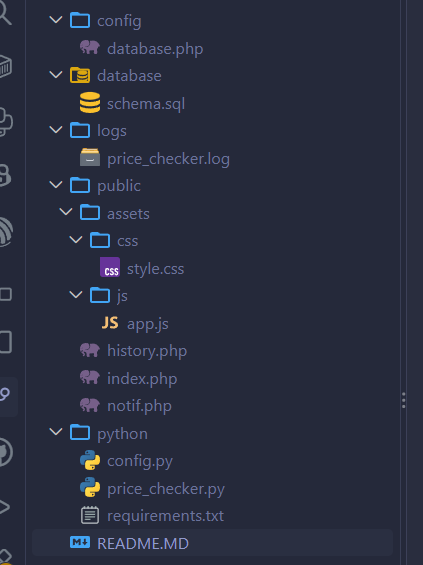

# PriceChuck
Веб-приложение для мониторинга цен на товары из интернет-магазинов.

## Технологии
- **PHP 8+** — веб-интерфейс
- **Python 3.8+** — парсер цен
- **MySQL 5.7+** — база данных

## Установка

### 1. База данных
```bash
mysql -u root -p < database/schema.sql
```

### 2. PHP-часть
Настрой подключение к БД в `config/database.php`:
```php
define('DB_USER', 'root');
define('DB_PASS', 'твой_пароль');
```

Запусти встроенный сервер:
```bash
php -S localhost:8000 -t public
```
Открой в браузере: http://localhost:8000

### 3. Python-часть
```bash
cd python
pip install -r requirements.txt
```

Настрой подключение в `python/config.py`:
```python
"password": "твой_пароль"
```

Запусти парсер:
```bash
python price_checker.py
```

### 4. Автоматический запуск (cron)
```bash
crontab -e
# Каждый час:
0 * * * * cd /путь/к/price-tracker/python && python price_checker.py
```

## Структура проекта
```
price-tracker/
├── public/          # Веб-интерфейс (PHP)
├── python/          # Парсер цен (Python)
├── config/          # Конфигурация
├── database/        # SQL-схема
└── logs/            # Логи парсера
```